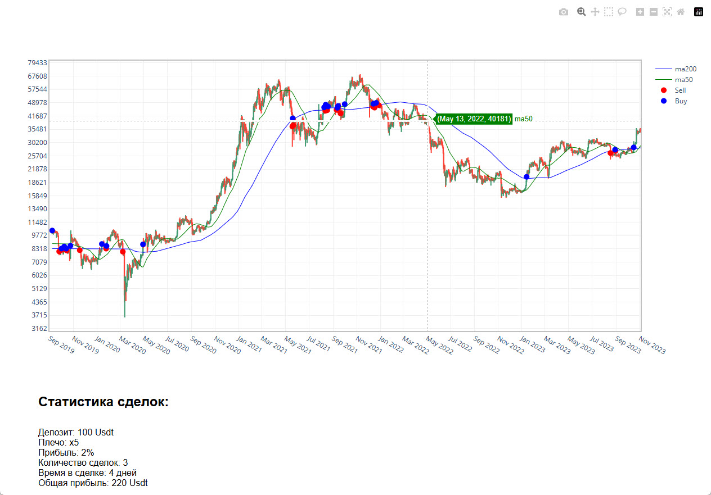
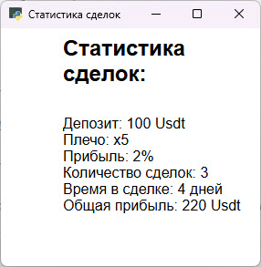

# Просмотрщик котировок Binance

Рабочее название: `binance`.

Приложение читает сохранённую историю котировок Binance, строит свечной график и открывает его в отдельном окне. Основная задача проекта - подготовка рыночных данных и наглядное отображение цены, скользящих средних и сигналов.

**Python-портфолио Евгения Толмачева** · Python · pandas · NumPy · Plotly · pywebview



## Скриншоты

<details>
<summary>Просмотрщик котировок Binance - 2 снимков</summary>

### Скриншот 1


### Скриншот 2



</details>

## Возможности

- Приводит сохранённые котировки к таблице с датой, ценами открытия/закрытия, максимумом, минимумом и объёмом.
- Рассчитывает MA50 и MA200 и отмечает переход цены выше или ниже MA200.
- Создаёт HTML-график с логарифмической шкалой, подсказками и маркерами Buy/Sell.
- Показывает график в окне pywebview и добавляет отдельный блок статистики.

## Как устроен проект

### Обработка и график

[`binance.py`](binance.py)

Читает локальный файл данных, рассчитывает средние и сигналы, сохраняет chart.html и запускает окно просмотра.

### Блок статистики

[`calculate_profit.py`](calculate_profit.py)

Формирует HTML с демонстрационными показателями; может открываться отдельным небольшим окном.

### Оформление окна

[`style.css`](style.css)

Задаёт размеры HTML-области, в которой отображаются график и статистика.

## Технологии и их роль

- **pandas и NumPy**: Обработка свечей, скользящие средние и выделение цен для маркеров.
- **Plotly**: Свечной график, линии индикаторов и интерактивные подписи.
- **pywebview**: Отображение HTML-графика в настольном окне.

## С чего начать просмотр кода


Основная последовательность обработки находится в binance.py. calculate_profit.py показывает, как к графику подключён отдельный HTML-блок.

## Подготовка и запуск

Создайте отдельное окружение и установите исходные зависимости:

```powershell
python -m venv .venv
.venv\Scripts\Activate.ps1
python -m pip install -r requirements.txt
```

Нужен локальный dataframe.pkl с ожидаемой структурой котировок. Окно pywebview зависит от установленного системного веб-движка.

После подготовки настроек и необходимых данных основная точка входа:

```powershell
python binance.py
```

`requirements.txt` сохранён из проекта. Это снимок окружения, а не гарантия совместимости с новейшей версией Python. Для старых проектов могут потребоваться соответствующая версия Python и настройка системных компонентов.

## Структура

```text
binance/
├── docs/
│   ├── preview.webp
│   └── screenshots/  # скриншоты из портфолио
├── .gitignore
├── binance.py
├── calculate_profit.py
├── README.md
├── requirements.txt
└── style.css
```

## Контекст и ограничения

Начат в 2022 году как прототип аналитического интерфейса. Работа сосредоточена на визуализации: значения прибыли и количества сделок в calculate_profit.py заданы вручную для демонстрации блока статистики, а не рассчитаны по истории торгов.

Проверены синтаксис Python-файлов и состав публикации. Полный запуск этой версии с внешними сервисами, локальными данными или моделями не выполнялся; команды выше описывают подготовку по исходникам.

## Состав репозитория

Сохранены авторские исходники, их имена и структура, зависимости и скриншоты интерфейса. Рабочие базы, наборы данных, модели и виртуальные окружения исключены. Секреты заменены обозначениями `YOUR_...` / `REDACTED_...`; реальные значения задаются локально. Исходные алгоритмы при оформлении портфолио не перерабатывались.

Автор: [Евгений Толмачев](https://github.com/EvgenyET) · [Портфолио](https://evgeny.tech/)
